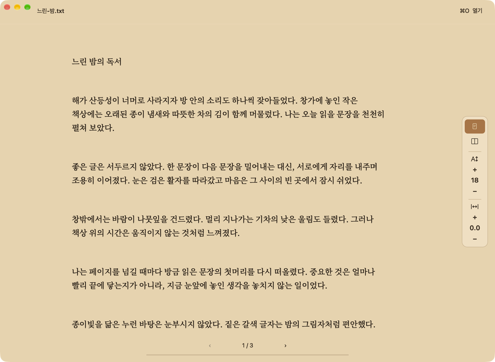
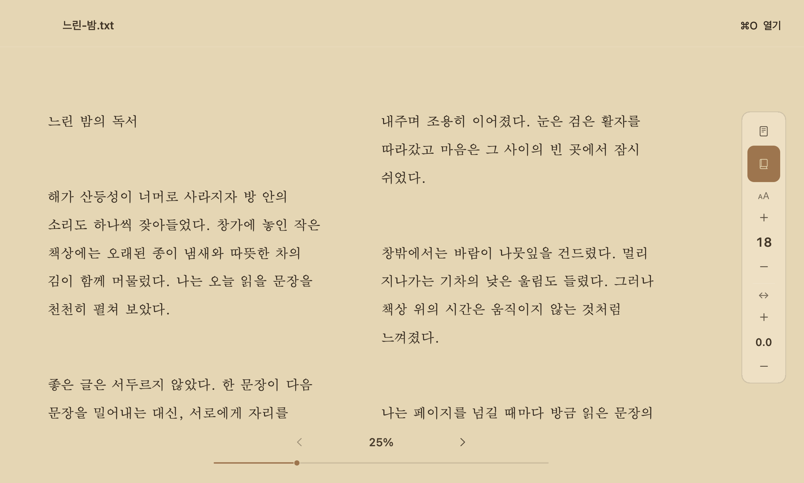

# Good Text Viewer

[English](README.md) · **한국어**

Good Text Viewer는 TXT 소설을 책처럼 읽을 수 있는 빠르고 가벼운 macOS·Windows 뷰어입니다. 한쪽·두쪽 보기, 글자 크기와 자간 조절, 오래된 문서의 줄바꿈 정리를 지원합니다.

앱은 시스템 언어에 맞춰 한국어와 영어로 표시됩니다. 오른쪽 패널에서 보기 방식, 글자 크기, 자간을 조절할 수 있습니다. 파일 → 최근에 읽은 파일에서 TXT 파일을 최대 10개까지 다시 열고 읽던 위치에서 이어갈 수 있습니다.

**대용량 TXT 지원.** 첫 페이지가 준비되면 바로 읽을 수 있고, 나머지 페이지는 백그라운드에서 계산합니다. 여유 메모리 범위에서 2GiB 미만 파일을 열 수 있습니다. macOS에서 100MB 파일을 연 결과는 [대용량 TXT 테스트](docs/qt-performance.md)에 기록했습니다.

- macOS 공개판은 Homebrew 또는 GitHub 릴리스에서 받을 수 있습니다. Windows 시험판은 아래 방법으로 빌드할 수 있습니다.
- 개발/배포: **Dev Dot.**

## Homebrew 설치

macOS 13 이상을 사용하는 Apple Silicon 및 Intel Mac에 Apple 공증을 받은 앱을 설치합니다.

```sh
brew install --cask arden-deq/tap/dev-dot-good-text-viewer
```

설치 후 응용 프로그램 폴더에서 **Good Text Viewer**를 실행하세요. Homebrew가 tap 신뢰를 요청하면 `brew trust --cask arden-deq/tap/dev-dot-good-text-viewer`를 실행한 뒤 설치를 다시 시도하세요.

Homebrew를 사용하지 않는다면 [GitHub 릴리스](https://github.com/arden-deq/Good-Text-Viewer/releases/latest)에서 macOS ZIP을 내려받아 압축을 풀고 앱을 응용 프로그램 폴더로 옮기세요. · [공식 홈페이지](https://goodtextviewer.allmightdev.com/ko/)

## 읽기 화면

저장소에 포함된 [예제 텍스트](Samples/느린-밤.txt)를 한쪽 보기와 두쪽 보기로 연 화면입니다.

| 한쪽 보기 | 두쪽 보기 |
| --- | --- |
|  |  |

## 빌드 및 실행

CMake 3.24 이상, C++20 컴파일러, Widgets와 Linguist Tools가 포함된 Qt 6.8이 필요합니다. macOS 유니버설 앱은 Xcode 16 이상과 유니버설 Qt SDK를 사용합니다. `CMAKE_PREFIX_PATH`를 Qt 설치 디렉터리로 지정한 뒤 프로젝트 루트에서 실행합니다.

```sh
make test
make run
```

`make run`은 `dist/qt/Good Text Viewer.app`을 빌드하고 실행합니다. 앱만 만들려면 `make package`, 유니버설 ZIP과 체크섬까지 만들려면 `make release`를 실행하세요.

Windows x64에서는 Qt SDK와 버전이 맞는 MinGW 및 Ninja를 사용합니다. Qt와 MinGW의 `bin`을 PATH에 추가하고, `CMAKE_PREFIX_PATH`를 Qt 설치 디렉터리로 지정한 뒤 실행하세요.

```powershell
./Scripts/package-windows.ps1
```

테스트 통과 후 `dist`에 포터블 ZIP이 만들어집니다. 압축을 푼 폴더에서 `GoodTextViewer.exe`를 실행하세요.

## 사용법

1. 앱을 실행합니다.
2. `⌘O`를 누르거나 **파일 > 열기…**에서 `.txt` 파일을 선택합니다. `.txt` 파일을 앱 창으로 끌어 놓아도 열립니다.
3. 한쪽 보기와 두쪽 보기를 바꾸고 글자 크기·자간을 읽기 편하게 조절합니다.
4. 하단 진행도 선을 드래그해 원하는 위치로 이동할 수 있습니다.
5. 방향키, Page Up/Page Down 또는 Space/Shift-Space로 페이지를 이동합니다.

지원 파일은 확장자가 `.txt`인 일반 텍스트입니다. 두 운영체제에서 UTF-8, UTF-16, 옛 한글 문서의 CP949를 자동 판별합니다.
오래된 고정폭 문서의 인위적인 줄바꿈은 반복 패턴이 강할 때만 자동으로 정리합니다. 최근 문서의 줄바꿈을 원문 그대로 보고 싶다면 **보기 > 오래된 문서 줄바꿈 자동 정리**를 끄면 됩니다.

Finder에서 파일을 열려면 `.txt` 파일을 보조 클릭한 뒤 **다음으로 열기 > Good Text Viewer**를 선택합니다. 앱을 `/Applications`로 복사해 두면 **다음으로 열기** 목록에서 찾기 쉽습니다.

## 키보드 단축키

Windows에서는 아래 표의 ⌘ 대신 Ctrl, ⌥ 대신 Alt를 사용합니다.

| 기능 | 단축키 |
| --- | --- |
| 텍스트 파일 열기 | `⌘O` |
| 한쪽 보기 | `⌘1` |
| 두쪽 보기 | `⌘2` |
| 글자 크게 | `⌘+` |
| 글자 작게 | `⌘-` |
| 자간 넓게 | `⌥⌘]` |
| 자간 좁게 | `⌥⌘[` |
| 다음 페이지 | `→`, `Page Down` 또는 `Space` |
| 이전 페이지 | `←`, `Page Up` 또는 `Shift-Space` |

## 패키징과 서명

`Scripts/package.sh`는 Qt 런타임이 포함된 macOS 앱 번들을 만들고 로컬 실행용 ad-hoc 서명을 적용한 뒤 서명을 검증합니다. 생성 위치는 다음과 같습니다.

```text
dist/qt/Good Text Viewer.app
```

이 서명은 현재 Mac에서 개발·실행하기 위한 것입니다. 다른 사용자에게 인터넷으로 배포하면 Gatekeeper가 앱을 차단할 수 있습니다. 공개 배포에는 **Developer ID Application** 인증서, hardened runtime 서명, Apple 공증(`notarytool`), staple 과정이 별도로 필요합니다.

앱 정보 창에는 버전과 개발/배포 사업자명 `Dev Dot.`가 표시됩니다. 번들 식별자는 `com.devdot.goodtextviewer`입니다.

## 일반 다운로드용 릴리스

다음 명령은 universal 앱과 SHA-256 파일을 만듭니다.

```sh
make release
```

생성 결과:

```text
dist/Good-Text-Viewer-1.1.1-macOS-universal.zip
dist/Good-Text-Viewer-1.1.1-macOS-universal.zip.sha256
```

기본 결과는 ad-hoc 서명된 로컬 검증본입니다. 공개 게시본은 Developer ID로 서명하고 Apple 공증을 마친 뒤 만들어야 합니다.

## Homebrew Cask 배포

공개 GitHub 릴리스에 위 ZIP을 업로드한 뒤 다음 명령으로 Cask를 생성합니다.

```sh
./Scripts/render-cask.sh <github-owner>/<app-repository>
```

결과는 `dist/qt/Casks/dev-dot-good-text-viewer.rb`입니다. 이 파일을 `<github-owner>/homebrew-tap` 저장소의 `Casks/`에 게시하면 사용자는 다음 형식으로 설치할 수 있습니다.

```sh
brew install --cask <github-owner>/tap/dev-dot-good-text-viewer
```

Developer ID 인증서와 `notarytool` 키체인 프로필을 준비한 환경에서는 아래 공개 배포 명령이 서명, 공증, staple, Gatekeeper 검사, ZIP, SHA-256, Cask 생성을 순서대로 수행합니다.

```sh
GOOD_TEXT_VIEWER_SIGNING_IDENTITY="Developer ID Application: …" \
GOOD_TEXT_VIEWER_NOTARY_PROFILE="notary-profile" \
./Scripts/make-publish-release.sh <github-owner>/<app-repository>
```

Homebrew 작업 파일과 체크리스트는 `Packaging/homebrew`에 있습니다.

## 라이선스

Good Text Viewer는 [MIT 라이선스](LICENSE)로 배포합니다.

## 정리

```sh
make clean
```

CMake 로컬 빌드 산출물을 정리합니다.
