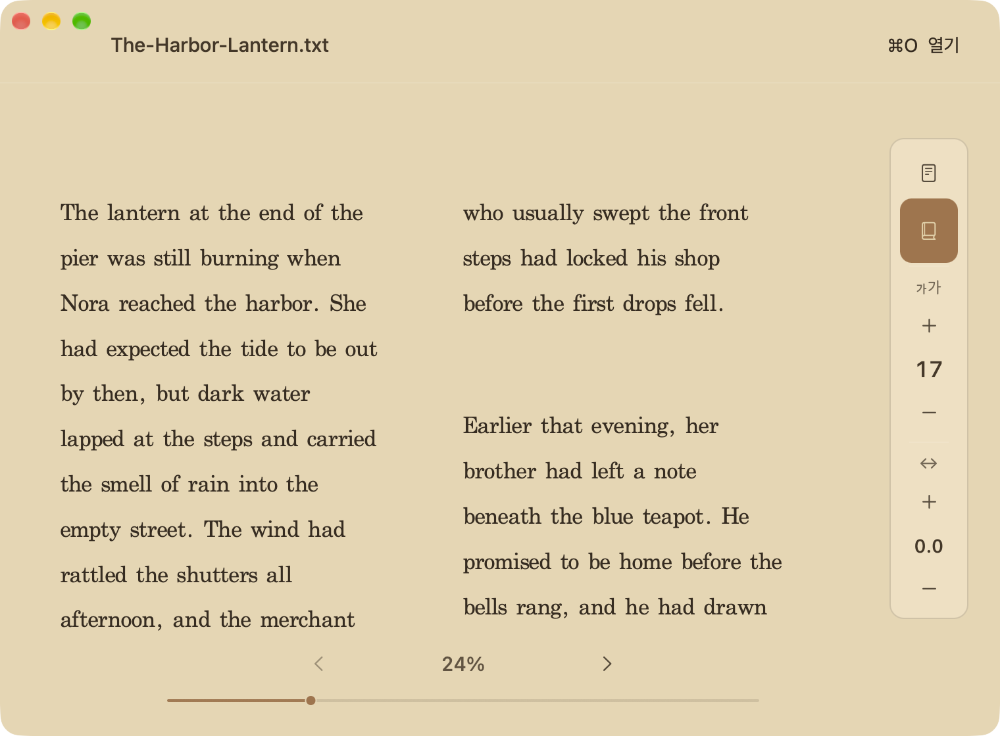
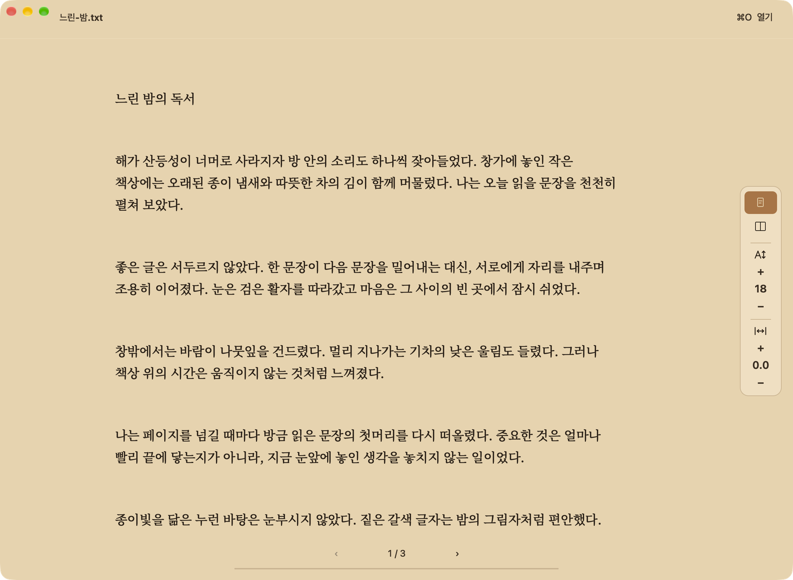

# Good Text Viewer

**English** · [한국어](README.ko.md)

Read plain-text novels like a book. Good Text Viewer is a fast, lightweight TXT reader for macOS and Windows, with single-page and two-page views, adjustable type, and optional cleanup for hard-wrapped lines in older files.

The app follows your system language for English and Korean. The side panel groups view mode, font size, and letter spacing.

**Large TXT files.** Start reading as soon as the first page is ready while the rest of the pages are laid out in the background. The app accepts files under 2 GiB, subject to available memory. See the [large TXT benchmarks](docs/qt-performance.md) for the macOS test with a 100 MB text file.

Built by **Dev Dot.** · [Latest release](https://github.com/arden-deq/Good-Text-Viewer/releases/latest)

## Install

The notarized macOS release supports macOS 13 or later on Apple Silicon and Intel Macs. For the Windows preview, see the build instructions below.

```sh
brew install --cask arden-deq/tap/dev-dot-good-text-viewer
```

Open **Good Text Viewer** from Applications. If Homebrew requires trust, run `brew trust --cask arden-deq/tap/dev-dot-good-text-viewer` and retry the installation.

You can also download the macOS ZIP from [GitHub Releases](https://github.com/arden-deq/Good-Text-Viewer/releases/latest), unzip it, and move the app to Applications.

## Try an English short story

Open [The Harbor Lantern](Samples/The-Harbor-Lantern.txt), an original English sample with fixed-width line breaks, and press `⌘2` for a two-page spread.



### Hard line breaks before and after cleanup

With cleanup off, the original file puts a hard line break in the middle of the first sentence:

```text
The lantern at the end of the pier was still burning when Nora
reached the harbor.
```

With cleanup on, it reads as one continuous sentence and wraps to fit the page:

> The lantern at the end of the pier was still burning when Nora reached the harbor.

The rest of the paragraph reflows the same way. Blank lines between paragraphs are preserved.

## Reading views

These screenshots show the [Korean sample](Samples/느린-밤.txt) in both reading modes.

| Single-page view | Two-page view |
| --- | --- |
|  |  |

## Read a file

1. Press `⌘O` or choose **File → Open…**. You can also drop a `.txt` file onto the window.
2. Choose a single page or a two-page spread. Adjust the font size and letter spacing with the controls on the right.
3. Turn pages with the keyboard or drag the progress bar at the bottom to jump to a position.

The reader detects UTF-8, UTF-16, and legacy Korean CP949 on both platforms. For older fixed-width documents, it can join hard-wrapped lines when it detects a strong pattern. Turn off **View → Clean up hard line breaks** to keep the original line breaks. On Windows, use Ctrl in place of ⌘ and Alt in place of ⌥ in the shortcuts below.

| Action | Shortcut |
| --- | --- |
| Open a text file | `⌘O` |
| Single-page view | `⌘1` |
| Two-page view | `⌘2` |
| Increase / decrease font size | `⌘+` / `⌘-` |
| Increase / decrease letter spacing | `⌥⌘]` / `⌥⌘[` |
| Next page | Right Arrow, Page Down, or Space |
| Previous page | Left Arrow, Page Up, or Shift-Space |

## Build from source

Install CMake 3.24+, a C++20 toolchain, and Qt 6.8 with Widgets and Linguist Tools. On macOS, use Xcode 16 or later and a universal Qt SDK. Set `CMAKE_PREFIX_PATH` to its Qt installation directory.

```sh
make test
make run
```

`make run` builds and opens `dist/qt/Good Text Viewer.app`. Use `make package` for the app bundle without opening it or `make release` for the universal ZIP and checksum.

On Windows x64, use the matching Qt and MinGW toolchain, Ninja, and CMake. With the Qt SDK's `bin` and matching MinGW `bin` directories on PATH and `CMAKE_PREFIX_PATH` set to the SDK directory, run:

```powershell
./Scripts/package-windows.ps1
```

This runs the tests and creates a portable ZIP in `dist`. Extract it before opening `GoodTextViewer.exe`.

For Developer ID signing, notarization, and Cask publishing, see the [Homebrew release guide](Packaging/homebrew/README.md).

## License

[MIT](LICENSE).
