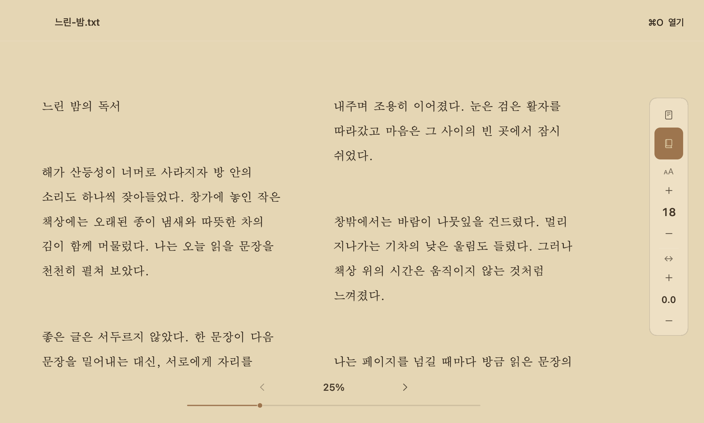

# Good Text Viewer

**English** · [한국어](README.ko.md)

Good Text Viewer is a lightweight native macOS reader for plain-text (`.txt`) files. It uses AppKit and offers single-page and two-page reading, adjustable typography, and optional line-wrap cleanup for older documents.

Built by **Dev Dot.** · [Latest release](https://github.com/arden-deq/Good-Text-Viewer/releases/latest)

## Install

The notarized app supports macOS 13 or later on Apple Silicon and Intel Macs.

```sh
brew install --cask arden-deq/tap/dev-dot-good-text-viewer
```

Open **Good Text Viewer** from Applications. If Homebrew requires trust, run `brew trust --cask arden-deq/tap/dev-dot-good-text-viewer` and retry the installation.

You can also download the macOS ZIP from [GitHub Releases](https://github.com/arden-deq/Good-Text-Viewer/releases/latest), unzip it, and move the app to Applications.

## Reading views

Both views show the [sample text](Samples/느린-밤.txt) included in this repository.

| Single-page view | Two-page view |
| --- | --- |
|  |  |

## Read a file

1. Press `⌘O` or choose **파일 → 열기…** (File → Open). You can also drop a `.txt` file onto the window.
2. Choose a single page or a two-page spread. Adjust the font size and letter spacing with the controls on the right.
3. Turn pages with the keyboard or drag the progress bar at the bottom to jump to a position.

The reader detects UTF-8 and supported legacy encodings, including CP949. For older fixed-width documents, it can join hard-wrapped lines when it detects a strong pattern. Turn off **보기 → 오래된 문서 줄바꿈 자동 정리** (View → Automatically clean up legacy line wraps) to keep the original line breaks.

| Action | Shortcut |
| --- | --- |
| Open a text file | `⌘O` |
| Single-page view | `⌘1` |
| Two-page view | `⌘2` |
| Increase / decrease font size | `⌘+` / `⌘-` |
| Increase / decrease letter spacing | `⌥⌘]` / `⌥⌘[` |
| Next page | Right Arrow, Page Down, or Space |
| Previous page | Left Arrow, Page Up, or Shift-Space |

## Build from source

Use Xcode 16 or later to build the universal app. The project has no external package dependencies.

```sh
make test
make run
```

`make run` builds and opens `dist/Good Text Viewer.app`. Use `make package` to build the app bundle without opening it, or `make build` to build just the executable.

For Developer ID signing, notarization, and Cask publishing, see the [Homebrew release guide](Packaging/homebrew/README.md).

## License

[MIT](LICENSE).
